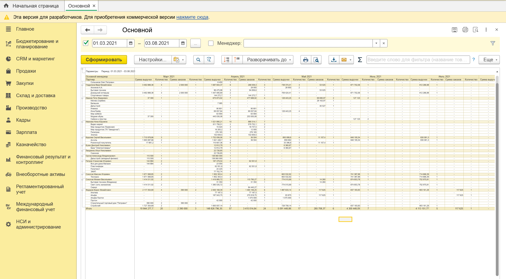

# Отчёт по продажам (СКД, 1С)

Внешний отчёт для 1С:Предприятие 8.3 на системе компоновки данных (СКД).
Показывает суммы заказов клиентов и выручки по месяцам в разрезе основных менеджеров и партнёров.



## Возможности

- строки: Основной менеджер → Партнёр, колонки: месяцы периода (формируются динамически)
- по каждому месяцу: сумма выручки, количество документов выручки, сумма заказов, количество заказов; итог по строке
- суммы с НДС и в рублях — валютные заказы пересчитываются по курсу
- произвольный период; без периода — за всё время; при заданном периоде выводятся все его месяцы, даже пустые
- отбор по одному или нескольким менеджерам
- расшифровка ячейки до документа-регистратора — отдельно для заказов и для выручки
- нулевые суммы выводятся прочерком
- без программирования: макет и форму строит платформа

## Источники данных

| Показатель | Источник |
|---|---|
| Заказы | `РегистрНакопления.ЗаказыКлиентов.Обороты` — только движения документов «Заказ клиента» |
| Выручка | `РегистрНакопления.ВыручкаИСебестоимостьПродаж.Обороты`, ресурс `СуммаВыручкиСНДСРеглОборот` |
| Менеджер | реквизит `ОсновнойМенеджер` справочника «Партнёры» |
| Курс валюты | `РегистрСведений.КурсыВалют.СрезПоследних` |

## Как устроен запрос

Пакет из двух запросов:

1. **ВТПродажи** — заказы и выручка, объединённые через `ОБЪЕДИНИТЬ ВСЕ`. У обеих частей одинаковый набор колонок; где у части нет данных, стоят заглушки `NULL` и `0`. Регистраторы заказа и выручки — отдельные поля, чтобы расшифровка вела к нужному документу.
2. **Итоговая выборка** — к ВТПродажи левыми соединениями подтягиваются основной менеджер партнёра и курс валюты заказа; сумма заказа пересчитывается в рубли. `ЕСТЬNULL(…, 1)` нужен для строк выручки, у которых валюты нет.

<details>
<summary>Текст запроса</summary>

```bsl
ВЫБРАТЬ
	ЗаказыКлиентовОбороты.Регистратор КАК РегистраторЗаказа,
	NULL КАК РегистраторВыручки,
	ВЫРАЗИТЬ(ЗаказыКлиентовОбороты.Регистратор КАК Документ.ЗаказКлиента).Партнер КАК Партнер,
	НАЧАЛОПЕРИОДА(ВЫРАЗИТЬ(ЗаказыКлиентовОбороты.Регистратор КАК Документ.ЗаказКлиента).Дата, МЕСЯЦ) КАК ПериодМесяц,
	СУММА(ЗаказыКлиентовОбороты.СуммаПриход) КАК СуммаЗаказа,
	0 КАК СуммаВыручки,
	ВЫРАЗИТЬ(ЗаказыКлиентовОбороты.Регистратор КАК Документ.ЗаказКлиента).Валюта КАК Валюта
ПОМЕСТИТЬ ВТПродажи
ИЗ
	РегистрНакопления.ЗаказыКлиентов.Обороты(, , Регистратор, ) КАК ЗаказыКлиентовОбороты
ГДЕ
	ЗаказыКлиентовОбороты.Регистратор ССЫЛКА Документ.ЗаказКлиента
СГРУППИРОВАТЬ ПО
	ВЫРАЗИТЬ(ЗаказыКлиентовОбороты.Регистратор КАК Документ.ЗаказКлиента).Партнер,
	ЗаказыКлиентовОбороты.Регистратор,
	НАЧАЛОПЕРИОДА(ВЫРАЗИТЬ(ЗаказыКлиентовОбороты.Регистратор КАК Документ.ЗаказКлиента).Дата, МЕСЯЦ),
	ВЫРАЗИТЬ(ЗаказыКлиентовОбороты.Регистратор КАК Документ.ЗаказКлиента).Валюта

ОБЪЕДИНИТЬ ВСЕ

ВЫБРАТЬ
	NULL,
	ВыручкаОбороты.Регистратор,
	ВыручкаОбороты.АналитикаУчетаПоПартнерам.Партнер,
	НАЧАЛОПЕРИОДА(ВыручкаОбороты.Период, МЕСЯЦ),
	0,
	СУММА(ВыручкаОбороты.СуммаВыручкиСНДСРеглОборот),
	NULL
ИЗ
	РегистрНакопления.ВыручкаИСебестоимостьПродаж.Обороты(, , Регистратор, ) КАК ВыручкаОбороты
СГРУППИРОВАТЬ ПО
	ВыручкаОбороты.Регистратор,
	ВыручкаОбороты.АналитикаУчетаПоПартнерам.Партнер,
	НАЧАЛОПЕРИОДА(ВыручкаОбороты.Период, МЕСЯЦ)
;

////////////////////////////////////////////////////////////////////////////////
ВЫБРАТЬ
	ВТПродажи.РегистраторЗаказа КАК РегистраторЗаказа,
	ВТПродажи.РегистраторВыручки КАК РегистраторВыручки,
	ВТПродажи.Партнер КАК Партнер,
	ВТПродажи.ПериодМесяц КАК ПериодМесяц,
	ВЫРАЗИТЬ(ВТПродажи.СуммаЗаказа * ЕСТЬNULL(КурсыВалют.Курс, 1) / ЕСТЬNULL(КурсыВалют.Кратность, 1) КАК ЧИСЛО(15, 2)) КАК СуммаЗаказа,
	ВТПродажи.СуммаВыручки КАК СуммаВыручки,
	Партнеры.ОсновнойМенеджер КАК ОсновнойМенеджер
ИЗ
	ВТПродажи КАК ВТПродажи
		ЛЕВОЕ СОЕДИНЕНИЕ Справочник.Партнеры КАК Партнеры
		ПО ВТПродажи.Партнер = Партнеры.Ссылка
		ЛЕВОЕ СОЕДИНЕНИЕ РегистрСведений.КурсыВалют.СрезПоследних(&КонецПериода, ) КАК КурсыВалют
		ПО ВТПродажи.Валюта = КурсыВалют.Валюта
```

</details>

## Настройки СКД

- **Ресурсы:** `СуммаЗаказа`, `СуммаВыручки` — Сумма; `КоличествоЗаказов`, `КоличествоВыручки` — Количество(Различные) по регистраторам (заглушки `NULL` не считаются)
- **Параметры:** `Период` (стандартный период), из него — `НачалоПериода` и `КонецПериода`
- **Дополнение периода** по месяцам на группировке `ПериодМесяц`
- **Условное оформление:** нулевые суммы — прочерк по центру

## Сборка .erf из исходников

Конфигуратор → открыть любой внешний отчёт → «Действия» → «Загрузить из файлов…» → выбрать `src/OtchetPoProdazham.xml` → «Файл» → «Сохранить как…» `.erf`.

## Проверено на

1С:ERP Управление предприятием 2.5.10.93 (демо-база), платформа 8.3.27.2130